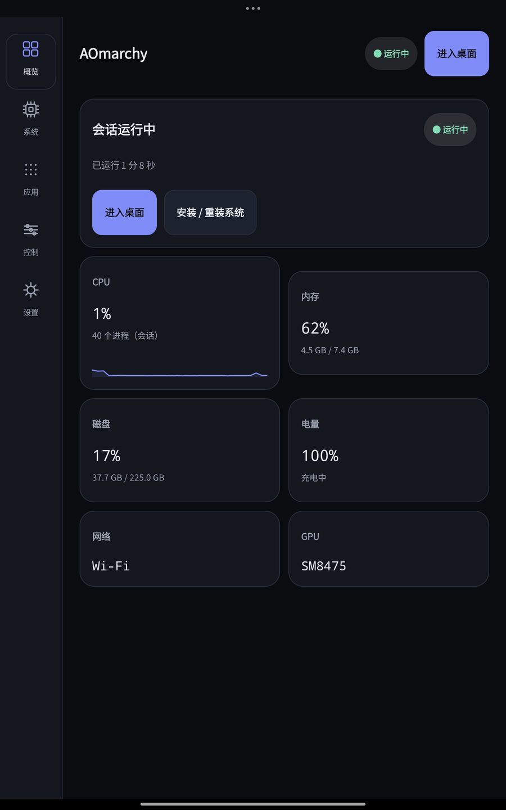
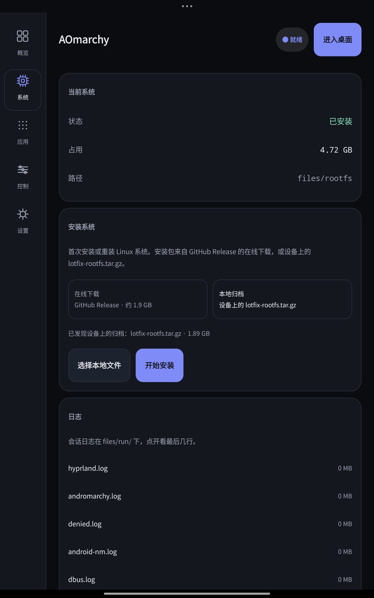
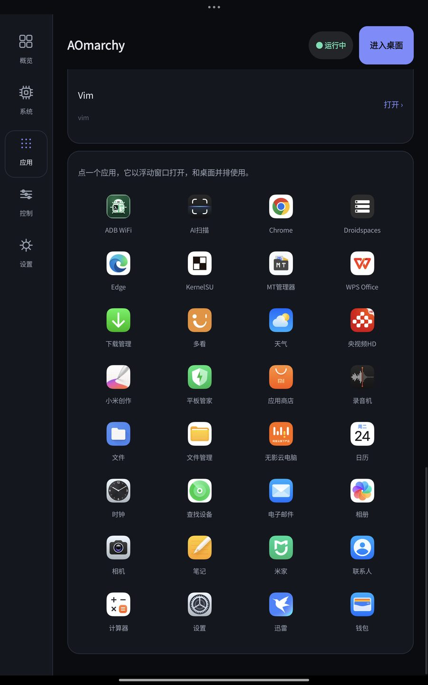
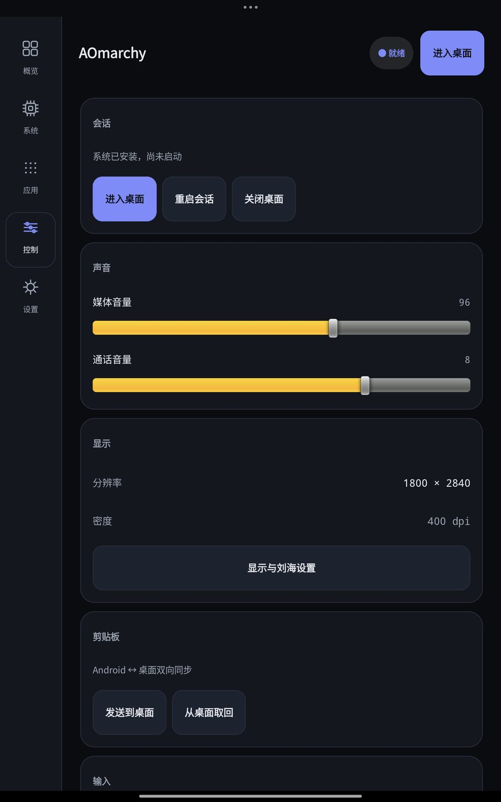
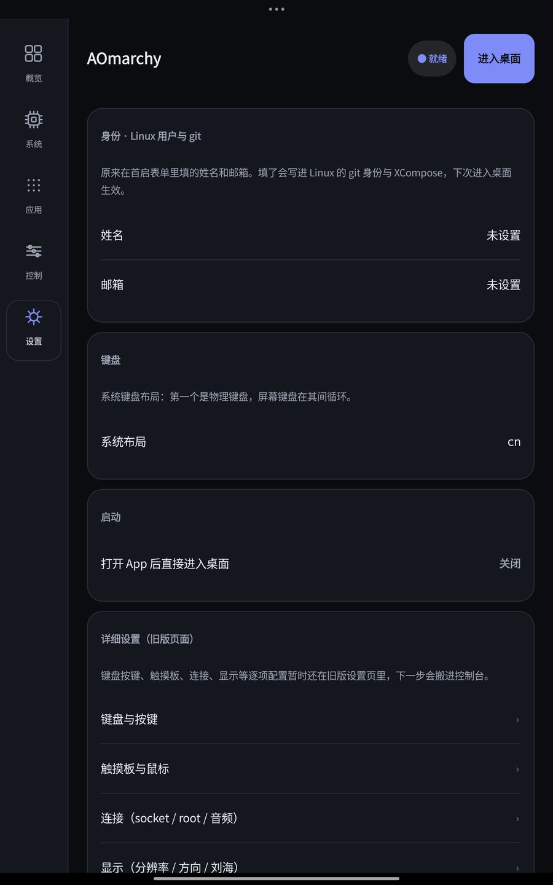
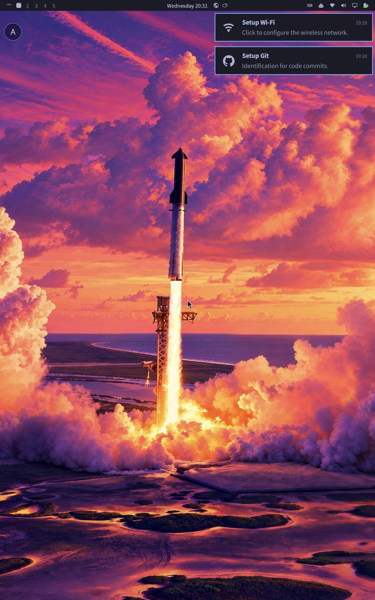
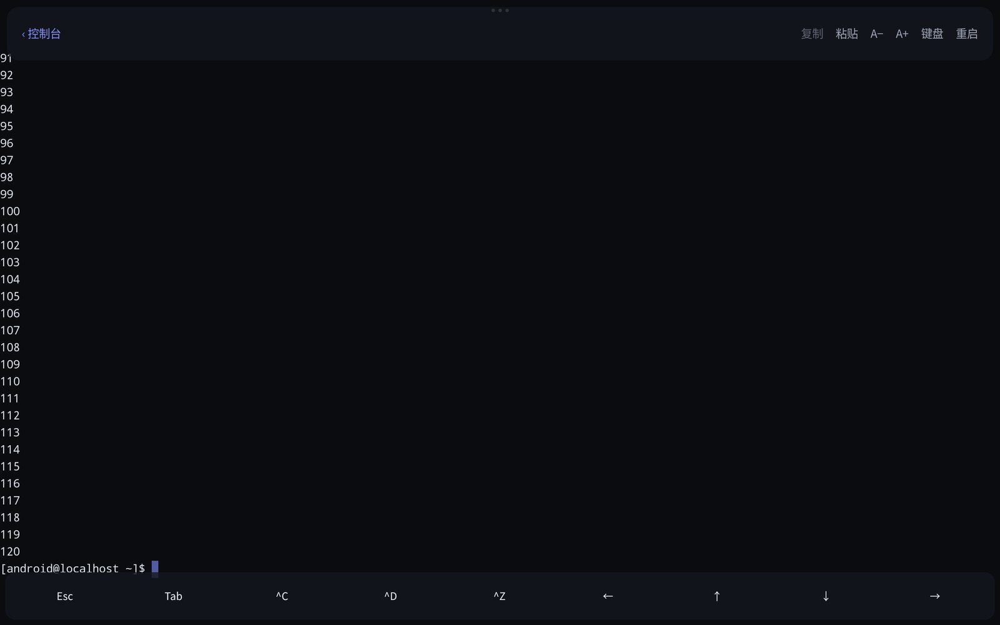

# AOmarchy

**Omarchy (Arch Linux + Hyprland) on Android, as one app. No root, no proot, no virtual machine.**

AOmarchy runs a full Arch Linux ARM desktop on an Android tablet. Linux programs run directly on the device, with
its GPU (Mesa Turnip/Freedreno on KGSL), sound, cameras, touch screen and on-screen keyboard. You get Omarchy's
desktop with its apps, the Flatpak store, Brave, VS Code, and anything else from Arch Linux ARM.

Watch full Demo on Youtube: (https://youtu.be/V79Su8oHRUI)

## Screens

The console around the desktop (2.0). Left to right: overview with live metrics, the system page (install, size,
logs), apps (Flatpak + Android floating windows), controls (volume, clipboard, power), settings (identity,
keyboard, startup).

| Console | System | Apps | Controls | Settings |
|---|---|---|---|---|
|  |  |  |  |  |

The desktop itself, with the small **A** handle that returns to the console without stopping the session:

**Terminal mode** (2.1): a login shell with no compositor, drawn by the app itself — about 700 MB less memory than
the desktop and a start in seconds, with scrollback, drag selection, copy/paste, font size and the keys a soft
keyboard does not have (Esc, Tab, ^C, ^D, ^Z, arrows):

## Requirements

- Android 11 or later, with a **Qualcomm Adreno GPU** (Snapdragon).
- About 15 GB of free space.
- Wi-Fi for the first launch, which downloads the system (about 1.9 GB) — unless you install from a local archive.

Developed and tested on a POCO Pad 2 Pro (Adreno 810, HyperOS / Android 16). Other Snapdragon tablets should work but
are untested.

## Install

1. Download `AOmarchy-release.apk` from the [latest release](../../releases/latest) and install it. Releases are built,
   signed and published by GitHub Actions (see [Building](#building)); each release also carries a `.sha256` file.
2. Open it: the app starts on its **console**, not straight in the desktop. Follow the short intro, then install the
   system from **系统 → 安装系统** — either the release download (about 1.9 GB), or a `lotfix-rootfs.tar.gz` you pick
   on the device (**Local archive**).
3. Press **进入桌面**. Omarchy's menu opens with **Super + Space**. Your name, email and keyboard layout now live in
   the settings (they are asked once, after the system is installed).
   Or switch **设置 → 启动方式** to **终端** and the same button opens a terminal instead of the desktop: one shell,
   no Hyprland, roughly 700 MB less memory — the quick way to run `pacman`.

> **2.0 uses the package name `app.aomarchy`.** Android does not let an app read another app's private data, so a
> 1.x install cannot be migrated: keep a copy of your files, uninstall the old app, then install AOmarchy and set the
> system up again (a local archive makes that offline).

The [user guide](docs/user-guide.md) explains the touch gestures, the on-screen keyboard, the Android settings to
change (HyperOS/MIUI take some gestures for themselves), installing apps, and the self-test.

## What's new in 2.1

- **Terminal mode.** 设置 → 启动方式 picks what the big button starts: the full desktop, or a terminal — one login
  shell in the installed system, without Hyprland, the bar or the app menu. The terminal is drawn by the app itself
  (VT100/ANSI: colours, cursor, scroll regions, alternate screen, CJK double-width cells), so it needs no VNC and no
  desktop. Measured on the tablet it saves about 700 MB of system memory and starts in seconds.
  It has scrollback (drag), selection (long press, then drag), copy/paste in the bar, font size (A− / A+) and a key
  strip for Esc, Tab, ^C, ^D, ^Z and the arrows.
- **Backup and restore.** 系统 → 备份与回滚 snapshots the whole Linux system to a `.tar.gz` (about 4.8 GB → 1.9 GB,
  a few minutes with progress and cancel), restores it, exports it to a file or imports one back. Restore swaps
  directories and rolls back on failure.
- **Motion and density.** The console got the Kinetik-style motion language in native code — the rail's flowing
  indicator, rolling numbers, card glints, spring progress bars, the morphing controls sheet and in-app toasts — and
  the pages were re-dense'd: fixed-height metric cards, one-line rows, merged display/input cards, more visible per
  screen.
- The A handle over the desktop keeps returning to the console (also from the session notification).

## What's new in 2.0

- **A console around the desktop.** The app now has five pages — **概览 / Overview, 系统 / System, 应用 / Apps,
  控制 / Controls, 设置 / Settings** — with the Linux desktop as one destination instead of the only screen.
  Tablet: left rail; phone/portrait: bottom bar.
- **The first-launch form is gone.** The system image is installed from the System page (with progress, retry and
  cancel), the name/email moved to Settings, and the keyboard layout is chosen where the keyboard lives. Nothing
  blocks you from looking around before downloading 2 GB.
- **Fixed brand dark theme**, independent from the desktop's Omarchy theme, so the console always looks the same.
- **Overview** shows session state and health; **System** owns install, backups and logs; **Apps** lists Flatpak
  sandboxes and Android apps in floating windows; **Controls** is the high-frequency switchboard (display, input,
  sound, power) that also opens from inside the desktop.

## How it works

- **No proot.** Programs run under a patched glibc loader, with `fakechroot` (made thread-safe) and `fakeroot` over
  TCP for the root filesystem view. A preloaded library (`native/android-compat.c`) covers what Android forbids to
  apps: blocked syscalls, hard links, `O_TMPFILE`, `/proc/self/exe`. Programs that make system calls themselves (Go,
  Bun, Free Pascal) get the same translation through a seccomp trap.
- **Display:** Hyprland on an Android backend for aquamarine. The app shows the output as an Android surface and
  forwards touch, keyboard, mouse and the clipboard.
- **GPU:** Mesa with KGSL support (no `/dev/dri` needed); XWayland is GPU-accelerated too.
- **Flatpak** without user namespaces: sandboxes are built as trees of links (`native/bwrap-flatpak.py`), with a
  document portal and `flatpak-spawn` stand-ins.
- **Updates are safe:** `pacman -Syu` works. Pacman hooks keep our builds (Mesa, Hyprland, aquamarine, fakechroot) in
  place across updates.
- **CJK text:** the Arch system has no Chinese/Japanese/Korean font, so the session copies the one Android already
  ships (`/system/fonts/NotoSansCJK-Regular.ttc`) into the rootfs. Without it, CJK text is drawn as empty boxes.
- **Shutdown / reboot / log out from the desktop:** work. Android has no logind, so Omarchy's power menu's
  `systemd-inhibit` wrapper is replaced by a shim that runs the wrapped command: Shutdown closes the session back to
  Android, Reboot and Log out start a fresh session. They cannot power the tablet off — no app can.

## Known limits

- Flatpak apps are not isolated from each other: Android gives apps no way to build real sandboxes.
- YouTube in Brave decodes video on the processor (hardware decoding works in `mpv` and `ffmpeg`).
- Old games that change the screen resolution (Allegro 4 and similar) are drawn full-screen but don't receive taps
  yet. Play them in windowed mode.
- There is no real administrator account: `sudo` installs and configures Linux software but cannot change Android.

## Building

`build/build-rootfs-native.sh` builds the system image on the device itself, inside a running AOmarchy, with
`build/build-inside.sh` (Mesa, XWayland, Hyprland, Squeekboard, fakechroot, Omarchy). The APK builds with Gradle in
`apk/`. The patches to upstream projects are in `patches/`.

### CI builds and releases

- `.github/workflows/build.yml` builds a **debug APK** on every push to `main`/PR (artifact on the run page).
- `.github/workflows/release.yml` publishes a **release**: push a `v*` tag (or run the workflow manually with a tag
  name). It builds the APK, writes `AOmarchy-release.apk.sha256` and creates the GitHub Release.
- Release signing uses the repository secrets `SIGNING_KEYSTORE_BASE64`, `SIGNING_STORE_PASSWORD`,
  `SIGNING_KEY_ALIAS` and `SIGNING_KEY_PASSWORD` (see the workflow for the format). Without them the release workflow
  still runs, but publishes a debug-signed pre-release instead.

## License and credits

GPL-3.0 (see [LICENSE](LICENSE)). The Android app is based on
[lfdevs/anland-termux](https://github.com/lfdevs/anland-termux) (GPL-3.0). AOmarchy uses lfdevs's Mesa for
Android, termux-va and XWayland patches, and builds on [Omarchy](https://github.com/basecamp/omarchy), Hyprland,
Arch Linux ARM, Mesa, Squeekboard, hyprgrass, PipeWire, Flatpak and fakechroot.
